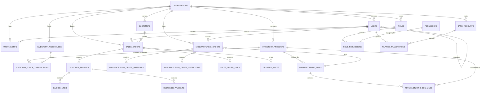

# Entity Relationship Diagram

## Core ER diagram for the secure foundation and modular monolith baseline

## Diagram notes

- `organization_id` is the primary tenant boundary across all operational and accounting tables.
- business actions are not allowed to bypass transactional service logic for inventory movement or ledger posting.
- audit history is explicitly separated from business tables and acts as a traceable event stream.
- several operational concepts such as branch, legal entity, and factory semantics are represented conceptually but remain pending confirmation before final schema commitment.

## Relationship and integrity rules

1. Organization-scoped master data is unique within an organization.
2. financial postings and inventory movements are not allowed to operate without a valid organization and transaction reference.
3. all order and production references remain in UUID form to avoid accidental collisions.
4. soft-delete or status-based inactivation is preferred over hard deletion for master data and approvals.
5. history tables must remain append-only for critical ledger and stock events.
